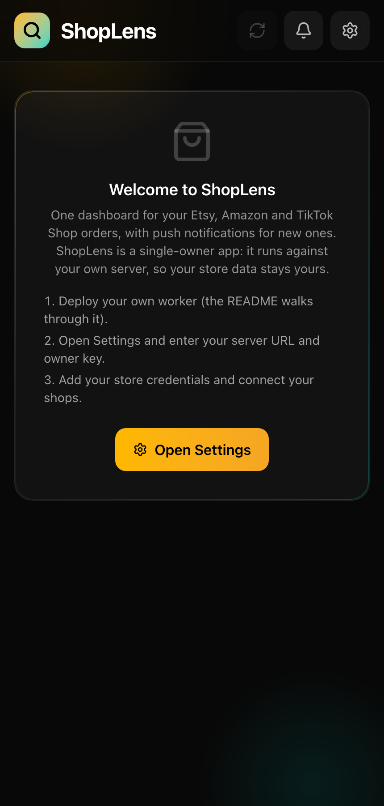
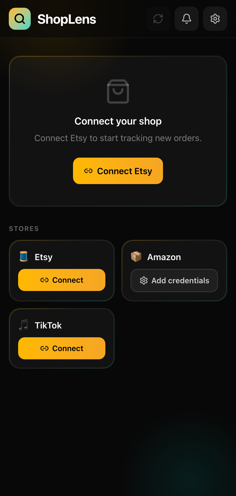
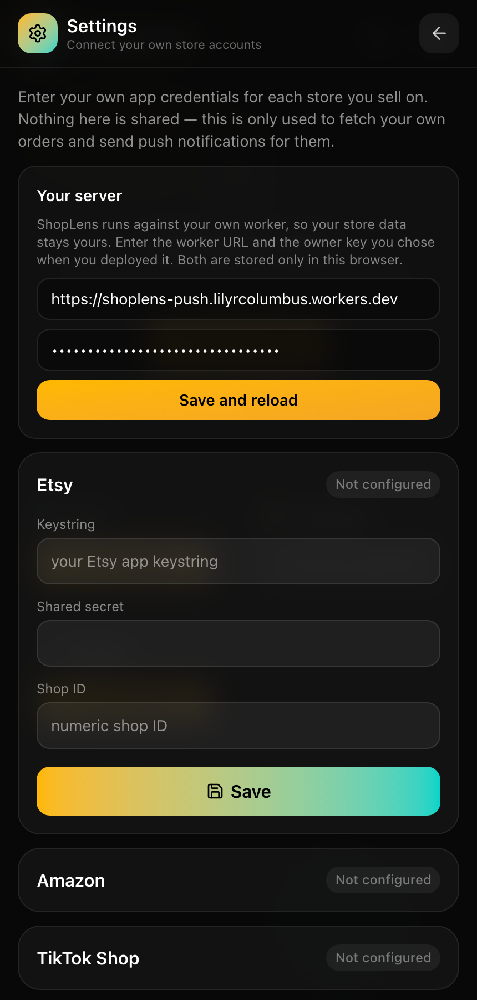

# ShopLens

A unified multi-store dashboard for e-commerce sellers: real orders from Etsy and Amazon in one place, with real-time push notifications when a new order comes in.

**Live demo:** [shoplens-7pi.pages.dev](https://shoplens-7pi.pages.dev)

## What it does

Sellers running multiple storefronts have to check each platform separately to know if they have new orders to ship. ShopLens polls every connected store on a schedule, aggregates real orders into one dashboard, and pushes a native notification to the seller's phone the moment something new comes in — installable as a PWA, so it behaves like a native app on iOS/Android.

## Screenshots

| First run | Connected to a server | Settings |
|---|---|---|
|  |  |  |

These show the app without any store connected: ShopLens never displays sample or mock orders, so the order, per-store and performance views only appear once you connect your own stores (see "Verify it yourself").

## Integrations

| Store | Status |
|---|---|
| Etsy | ✅ Live — OAuth (PKCE), orders + listings (stock/price/views/favorites) |
| Amazon | ✅ Live — SP-API, 4 marketplaces, orders + Sales & Traffic analytics |
| TikTok Shop | 🟡 In review with TikTok (app submitted, awaiting their data-access approval) |

## Key features

- **Bring your own store connections** — no account is hardcoded. Anyone running their own copy enters their own Etsy/Amazon/TikTok app credentials from Settings; they're stored server-side (Cloudflare KV), never shipped in the client bundle
- **Real background push notifications** — a standalone Cloudflare Worker polls every 10 minutes and sends Web Push via VAPID; verified end-to-end delivering to a real iPhone lock screen
- **AI advisor** — a chat grounded in your own real order/traffic data (Claude API) that diagnoses what's actually slowing sales down and suggests next steps, with a hard rule against ever suggesting marketplace-policy workarounds
- **Per-store dashboards** — tapping a store card opens its real orders (product, buyer, amount, status, date), no mock data anywhere
- **Cross-channel performance view** — revenue, order volume, and store-health indicators, currency-aware (never sums across currencies)
- **Installable PWA** — auto-updating service worker, works from the home screen

## Tech stack

- React 19, TypeScript, Vite, Tailwind CSS
- Cloudflare Pages + Pages Functions (Etsy/TikTok OAuth, AI advisor proxy)
- Standalone Cloudflare Worker for cron polling + Web Push + store API calls, backed by Cloudflare KV
- Amazon SP-API, Etsy API v3, TikTok Shop API, Claude API

## Security model

ShopLens is a **single-owner** app: there are no user accounts. Each deployment belongs to one seller, and everything that touches that seller's data is protected by an **owner key**:

- Every worker route (orders, listings, connection settings, push subscriptions, manual poll) requires an `x-shoplens-key` header that matches the worker's `OWNER_KEY` secret. The check is constant-time, and the worker refuses to serve anything if the secret isn't configured.
- The AI advisor proxy (`/api/agent`) checks the same key, so nobody else can spend the owner's Anthropic credits.
- The owner enters the server URL and the key once in **Settings → Your server**; both are kept only in that browser's `localStorage` and never bundled into the app.
- Store credentials (Etsy, Amazon, TikTok) are entered in Settings and stored server-side in Cloudflare KV, never in the client bundle.
- Only the OAuth entry points (`/etsy/authorize-url`, `/tiktok/authorize-url`, `/tiktok/exchange`) are reachable without the key: they hand out public authorize URLs or exchange a single-use code issued to this app.

Because the app is not tied to any one server, the public demo opens on a welcome screen: anyone can point it at **their own worker** from Settings, connect their own stores and use every feature, without depending on the maintainer's server or key. The maintainer's data is never exposed.

## Verify it yourself (deploy your own copy)

You need a free Cloudflare account and your own store API credentials (an Etsy developer app and/or Amazon SP-API credentials). The backend is a Cloudflare Worker (it relies on Workers KV and cron triggers), so Cloudflare is the supported host.

1. **Install**
   ```bash
   git clone https://github.com/lilyrcolumbus-hash/shoplens.git && cd shoplens
   npm install && (cd worker && npm install)
   ```
2. **Create the worker's storage** and put the returned id in `worker/wrangler.jsonc` (`kv_namespaces[0].id`):
   ```bash
   cd worker && npx wrangler kv namespace create PUSH_KV
   ```
3. **Generate push keys and choose an owner key**, then store them as worker secrets:
   ```bash
   npx web-push generate-vapid-keys        # prints a public and a private key
   npx wrangler secret put VAPID_PUBLIC
   npx wrangler secret put VAPID_PRIVATE
   npx wrangler secret put VAPID_SUBJECT   # e.g. mailto:you@example.com
   npx wrangler secret put OWNER_KEY       # any long random string you choose
   ```
4. **Deploy the worker** and note its URL: `npx wrangler deploy`
5. **Get the app.** You can use the hosted app at the demo URL (it works with any worker: you point it at yours in step 7), or deploy your own copy to Cloudflare Pages (connect the repo, build command `npm run build`, output `dist`). Optional settings for your own Pages project:
   - `OWNER_KEY` (same value as the worker) and `ANTHROPIC_API_KEY`: required only for the AI advisor, which runs as a Pages Function.
   - `SHOPLENS_WORKER_URL`: only for the TikTok connection flow.
   - Build variable `VITE_WORKER_URL`: pre-fills your worker URL so you don't have to type it in Settings.
6. **Register your Etsy app's redirect URI** as `https://<the-app-domain>/api/etsy/callback` (the domain where you open the app).
7. **Use it:** open the app → **Settings → Your server** → enter your worker URL and owner key → **Save and reload** → enter your Etsy / Amazon / TikTok credentials → tap **Connect** on each store.

What you should see: each connected store appears as a tile; tapping it opens that store's real orders (product, buyer, amount, status, date); the performance view shows revenue and order volume per currency; the worker polls every 10 minutes and sends a push notification when a new order arrives.

## Running locally

```bash
npm install
npm run dev
```

Visit `http://localhost:5173`, open Settings, and enter your worker URL and owner key (or put `VITE_WORKER_URL` in a `.env.local` to pre-fill it), then enter your store credentials. An `ANTHROPIC_API_KEY` (set as a Cloudflare Pages secret) is only needed for the AI advisor.
